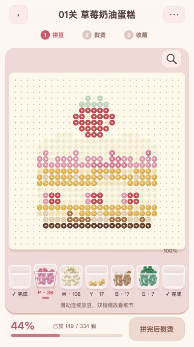
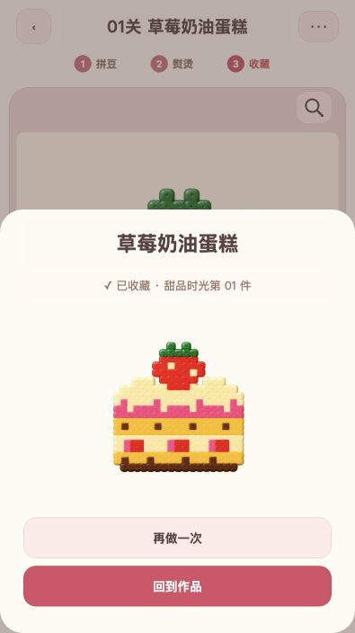

<div align="center">

# 🍓 拼拼豆豆儿

**一颗一颗拼出自己的草莓奶油蛋糕。**

一个用 Cocos Creator 制作的拼豆小游戏，支持浏览器试玩与微信小游戏构建。

`28 × 28 底板`　·　`334 颗豆子`　·　`7 种颜色`

[开始试玩](#在本地试玩) · [游戏玩法](#游戏玩法) · [开发指南](#开发指南) · [项目文档](#项目文档)

</div>

<br>

<div align="center">
  
  &nbsp;&nbsp;
  
  <br>
  <sub>选色、放豆，慢慢完成图案　　·　　熨烫、揭纸，把作品收入收藏</sub>
</div>

## 关于这个项目

「拼拼豆豆儿」把拼豆手作搬到屏幕上。目前包含甜品岛、萌宠森林、日常小物 **三个主题，共 18 关**：选择颜色，点按或滑动填满图案，再通过熨烫和揭纸完成作品。进度保存在当前设备，随时可以回来继续制作。

> MVP 提供甜品岛关卡地图、继续制作入口、三个主题共 18 个关卡，各主题独立顺序解锁、自制图纸与作品集。通关后可直接进入下一关，自制作品完成后也会出现在作品集中。微信小游戏仍需使用自己的 AppID 构建，并在开发者工具及真机上验证。

## 关卡主题

在「关卡选择」顶部切换主题，每个主题的第一关均可直接开始，后续关卡在主题内顺序解锁。

- **甜品岛**：原有草莓蛋糕、苏打、布丁等 6 关，原进度保留。
- **萌宠森林**：围巾兔兔、蝴蝶结小猫、柴柴、熊猫、爱心小熊、蓝帽企鹅，共 6 关。
- **日常小物**：草莓奶茶、拍立得、游戏机、花花盆栽、兔兔闹钟、小书包，共 6 关。

新增图纸均为 28×28 拼豆板、6–9 色；可继续制作、熨烫和收藏，全部成品汇入作品集。

## 游戏玩法

1. **选颜色**：点击底部豆盒打开抽屉，再选择要使用的颜色。关闭抽屉会取消选色。
2. **拼图案**：在对应的浅色位置点按或滑动，连续放置豆子。
3. **找一找**：点击放大镜，定位并标记一颗尚未完成的豆子。
4. **完成作品**：全部拼好后拖动熨斗覆盖作品，揭纸并收藏。

手机支持双指缩放和平移；电脑可用滚轮缩放，右键拖动或按住空格再左键拖动平移。设置和作品抽屉可点击外侧蒙层收起。重新制作不会删除已收藏的作品；存档保存在当前浏览器或微信本机，不跨设备同步。

## 在本地试玩

本仓库提供的是项目源码，需要先构建网页版本，再启动本地预览服务。

**准备环境**

- 安装 [Cocos Creator 3.8.8](https://www.cocos.com/creator)，并将 `COCOS_EDITOR` 指向编辑器可执行文件。
- 安装 Node.js 和 pnpm。本项目实测使用 Node.js 24.19.0、pnpm 11.25.0。

```bash
pnpm install --frozen-lockfile
pnpm build:web
python3 scripts/preview.py --port 4312
```

然后打开 **[http://127.0.0.1:4312/first-level/](http://127.0.0.1:4312/first-level/)**。这是本机地址，只有预览服务运行时才能访问。

预览服务仅监听本机，并通过版本路径和禁用缓存避免使用旧资源。本地进度仍保存在同一浏览器来源下。

### 自制图纸

在首页底部点击「自制图纸」，再点击「选图制作」。默认使用小板 14×14，也可选择中板 21×21、大板 29×29；满板分别为 196、441、841 颗豆，实际用豆数只统计图案占用的格子。图案等比居中放入所选底板，切换尺寸会重新生成。游戏从原图提取色板，最多使用 14 种颜色。生成后可以对照原图和成品，点按任一张图放大，或在「调整图纸」里切换裁切和去白底。可以保存到「我的图纸」稍后拼，也可以直接开拼。图片在本机转换，个人图纸及进度单独存储。

打印时可选择 **2.6mm / 5mm 孔距**，生成 A4 图纸和 50mm 校准尺，并附带色号与用豆清单。打印对话框选择 **100% / 实际大小**，关闭页眉页脚；先用尺子核对 50mm 校准线，再对照自己的拼板孔距。14/21/29 指图纸格数，不代表所有品牌的实体板规格。小板适合简单图标，照片和复杂轮廓建议选大板；有限格数不能保留所有照片细节。

### 试玩围巾小猫

启动同一个预览服务后，打开 [围巾小猫试玩](http://127.0.0.1:4312/first-level/?sample=life-011)。这张 34 × 34 图纸有 745 颗豆子和 14 种颜色。左右拖动底部豆盒可浏览颜色，点击豆盒选色。退出或刷新后可从同一个地址继续，收藏保存在本机的试玩记录里。

### 试玩甜品店橱窗

打开 [甜品店橱窗试玩](http://127.0.0.1:4312/first-level/?sample=life-016)。这张 44 × 44 图纸有 1,146 颗豆子和 12 种颜色，打开即可拼整张橱窗。进度与收藏保存在这张图独立的本机试玩记录里。

## 开发指南

| 命令 | 用途 |
| --- | --- |
| `pnpm build:web` | 构建网页版本，输出到 `build/first-level/` |
| `pnpm check` | 运行类型检查、关卡校验和逻辑测试 |
| `pnpm build:wechat` | 构建微信小游戏，输出到 `build/wechatgame/` |

从图片制关时，先看成品预览并标出轮廓、表情等关键部位，再运行
`pnpm validate:levels --draft <关卡.json> <细节标注.json>`。
细节标注包含 `levelId` 和 `details`。每个区域填写 `label`、`bounds: [左, 上, 宽, 高]`、检查用的色号 `colors`，
以及 `parts` 中各部件的 `label` 和 `anchors: [[列, 行], ...]`。坐标从 0 开始，同一部件的锚点须相连，不同部件须留出间隔。
可用 `minCells`、`maxCells` 限制部件格数，用 `edgeConnected: true` 要求笑嘴等笔画沿格边相接，
用 `gaps: [[列, 行, 色号?], ...]` 保留凹口（省略色号表示空格），用 `enclosedColors` 检查填色是否被轮廓围住。
每个区域内被检查的色号都应归到一个部件。标注由制关者参照原图填写。

首次打开或构建项目时，Cocos Creator 会生成引擎类型声明，之后即可运行类型检查。构建脚本会检查启动场景和引擎内置资源，日志位于 `logs/`；构建成功后仍需实际试玩。

微信构建配置使用官方示例测试 AppID。请在 `config/build-wechat.test.json` 中替换为自己的小游戏 AppID，重新构建后导入微信开发者工具。

<details>
<summary><strong>项目结构与构建细节</strong></summary>

- `assets/scenes/Game.scene`：游戏入口场景。
- `assets/scripts/core/`：不依赖引擎的游戏规则。
- `assets/scripts/game/`：游戏显示与输入。
- `assets/scripts/platform/`：浏览器与微信存储适配。
- `designs/bead-game/`：已确认的设计原型，游戏运行不依赖该 HTML。
- `extensions/import-ready/`：在资源数据库启动前短暂等待，处理本机 Cocos Creator 3.8.8 命令行冷启动时导入器尚未注册的问题。若日志提示找不到 importer，构建会失败。

</details>

## 项目状态

当前通过 78 项逻辑测试、类型检查和关卡校验。网页端已实测自制图纸的选图、预览、连续放豆、刷新续做及熨烫收藏。微信测试包已构建，开发者工具和真机验证待完成。原有玩法的详细记录见 [首关开发记录](docs/首关开发记录.md)。

## 项目文档

[开发规格](docs/开发规格.md) · [首版产品需求](docs/首版产品需求.md) · [实施计划](tasks/plan.md) · [任务清单](tasks/todo.md)

## 开源许可

本项目采用 [Apache License 2.0](LICENSE)。
