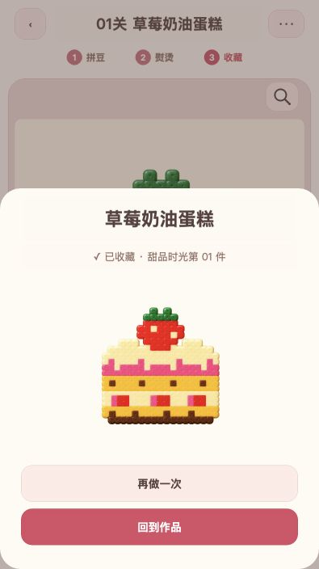

<div align="center">

# 🍓 甜品时光

**一颗一颗拼出自己的草莓奶油蛋糕。**

一个用 Cocos Creator 制作的拼豆小游戏首关，支持浏览器试玩与微信小游戏构建。

`28 × 28 底板`　·　`334 颗豆子`　·　`7 种颜色`

[开始试玩](#在本地试玩) · [游戏玩法](#游戏玩法) · [开发指南](#开发指南) · [项目文档](#项目文档)

</div>

<br>

<div align="center">
  
  &nbsp;&nbsp;
  
  <br>
  <sub>选色、放豆，慢慢完成图案　　·　　熨烫、揭纸，把作品收入收藏</sub>
</div>

## 关于这个项目

「甜品时光」把拼豆手作搬到屏幕上。目前已完成第一关 **草莓奶油蛋糕**：选择颜色，点按或滑动填满图案，再通过熨烫和揭纸完成作品。进度保存在当前设备，随时可以回来继续制作。

> 当前版本提供一关。首页、完整关卡选择、20 关内容和自由创作尚未实现。微信小游戏仍需使用自己的 AppID 构建，并在开发者工具及真机上验证。

## 游戏玩法

1. **选颜色**：点击底部豆盒打开抽屉，再选择要使用的颜色。关闭抽屉会取消选色。
2. **拼图案**：在对应的浅色位置点按或滑动，连续放置豆子。
3. **找一找**：点击放大镜，定位并标记一颗尚未完成的豆子。
4. **完成作品**：全部拼好后拖动熨斗覆盖作品，揭纸并收藏。

手机支持双指缩放和平移；电脑可用滚轮缩放，右键拖动或按住空格再左键拖动平移。设置和作品抽屉可点击外侧蒙层收起。重新制作不会删除已收藏的作品；存档保存在当前浏览器或微信本机，不跨设备同步。

## 在本地试玩

本仓库提供的是项目源码，需要先构建网页版本，再启动本地预览服务。

**准备环境**

- 安装 [Cocos Creator 3.8.8](https://www.cocos.com/creator)，并将 `COCOS_EDITOR` 指向编辑器可执行文件。
- 安装 Node.js 和 pnpm。本项目实测使用 Node.js 24.19.0、pnpm 11.25.0。

```bash
pnpm install --frozen-lockfile
pnpm build:web
python3 scripts/preview.py --port 4312
```

然后打开 **[http://127.0.0.1:4312/first-level/](http://127.0.0.1:4312/first-level/)**。这是本机地址，只有预览服务运行时才能访问。

预览服务仅监听本机，并通过版本路径和禁用缓存避免使用旧资源。本地进度仍保存在同一浏览器来源下。

## 开发指南

| 命令 | 用途 |
| --- | --- |
| `pnpm build:web` | 构建网页版本，输出到 `build/first-level/` |
| `pnpm check` | 运行类型检查、关卡校验和逻辑测试 |
| `pnpm build:wechat` | 构建微信小游戏，输出到 `build/wechatgame/` |

首次打开或构建项目时，Cocos Creator 会生成引擎类型声明，之后即可运行类型检查。构建脚本会检查启动场景和引擎内置资源，日志位于 `logs/`；构建成功后仍需实际试玩。

微信构建配置使用官方示例测试 AppID。请在 `config/build-wechat.test.json` 中替换为自己的小游戏 AppID，重新构建后导入微信开发者工具。

<details>
<summary><strong>项目结构与构建细节</strong></summary>

- `assets/scenes/Game.scene`：游戏入口场景。
- `assets/scripts/core/`：不依赖引擎的游戏规则。
- `assets/scripts/game/`：游戏显示与输入。
- `assets/scripts/platform/`：浏览器与微信存储适配。
- `designs/bead-game/`：已确认的设计原型，游戏运行不依赖该 HTML。
- `extensions/import-ready/`：在资源数据库启动前短暂等待，处理本机 Cocos Creator 3.8.8 命令行冷启动时导入器尚未注册的问题。若日志提示找不到 importer，构建会失败。

</details>

## 项目状态

已记录的验证包括 32 项纯逻辑测试、类型检查、关卡校验，以及浏览器中从拼豆到收藏的完整流程和刷新恢复。微信测试包重新导出、微信开发者工具和真机验证仍待完成。详细结果与未测项见 [首关开发记录](docs/首关开发记录.md)。

## 项目文档

[开发规格](docs/开发规格.md) · [首版产品需求](docs/首版产品需求.md) · [实施计划](tasks/plan.md) · [任务清单](tasks/todo.md)

## 开源许可

本项目采用 [Apache License 2.0](LICENSE)。
