# 首关开发记录

2026-10-18 · Cocos Creator 3.8.8 · M1 本地试玩完成，微信真机待验证

## 已实现

草莓奶油蛋糕沿用已确认图纸，28×28、334 颗、7 色。使用 Cocos 场景、精灵、UI 和触摸事件；核心规则独立于引擎。保留奶油白、浅暖粉、草莓红配色，四个缩放/移动按钮未加入。

可选色、点按、连续滑动；错误颜色和重复位置不计数。固定色板显示剩余数与完成标记，找一找自动放大并居中一颗漏豆，以持续闪动描边和箭头标记。实现 1～3 倍缩放、双指平移和松指等待状态；所有倍率均可单指或左键滑动铺豆。电脑滚轮缩放，右键或空格加左键拖动移图。

全部拼好后可以熨烫，覆盖过的豆子变成融合形态；全部覆盖后，点击按钮或在棋盘开始一次手势可揭纸。收藏与通关在同一份记录中保存成功后才展示成品。首关没有通向不存在的第二关的按钮。

本地 A/B 快照带版本、序号和校验值，回读验证成功才视为保存成功。约 200ms 合并保存，并在手势结束、阶段切换和切后台时保存。损坏记录尝试备用槽，无法恢复时给出重试或备份后新开一局；失败不会静默清空。突然终止仍可能丢失最后一次尚未提交的操作。

## 实际验证

| 项目 | 结果 |
| --- | --- |
| TypeScript 严格检查 | 通过 |
| 关卡校验 | 334 颗、7 色，通过 |
| Vitest 纯逻辑测试 | 27 项通过 |
| Web 构建与资源完整性 | 通过；清理 library 和导入缓存后重新构建也通过，实际载入并操作 |
| 微信小游戏测试包 | 已导出，入口与竖屏配置存在；未导入微信工具或真机运行 |
| 实际点击错误色、空白、重复位置 | 不增加数量 |
| 实际连续拖动七色 | 完成 334/334，按钮正确解锁 |
| 滚轮缩放后点按 | 120% 位置命中正确，重复点按仍只计一颗 |
| 找一找 | 自动放大居中单颗未完成目标，持续标记；可轮换，填好后取消，不自动补豆 |
| 拼豆中刷新 | 37/334 恢复一致 |
| 熨烫中刷新 | 9% 覆盖恢复一致 |
| 熨烫全部覆盖 | 进入待揭纸，点击完成按钮可收藏 |
| 待揭纸刷新 | 仍然待揭纸，不提前领取 |
| 已收藏刷新 | 成品保留，可以查看作品 |
| 重新制作 | 制作进度回到 0，原收藏保留 |
| 设置中的音效开关 | 开/关显示和本机保存正常；实际声音及中断待真机验证 |
| 390×690 较短屏幕 | 标题、棋盘、色板与底部操作均在画面内 |

测试在本机内置 Chromium 浏览器完成，主视口为 390×844，并检查 390×690 布局。最终版本控制台未见新增警告或错误。纯逻辑测试还覆盖图纸非法数据、连续路径穿格、边界裁剪、双指松开状态、存档截断回退、写失败/验证失败、领取重试与去重。浏览器刷新测试不能代替微信切后台和系统强杀测试。

开发中修复了 UI 左下角坐标与居中摄像机坐标不一致导致无法落豆的问题，并增加回归用例。修复集合序列化在引擎构建转换后的兼容问题，以及颜色辅助函数覆盖透明度导致纸张不透明的问题。

## 截图

初始制作页面：

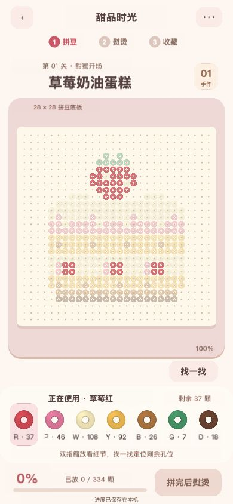

拼豆完成：

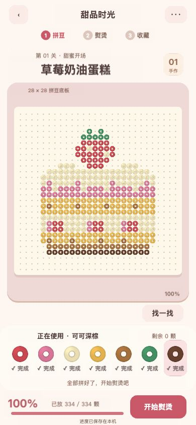

熨烫过程：

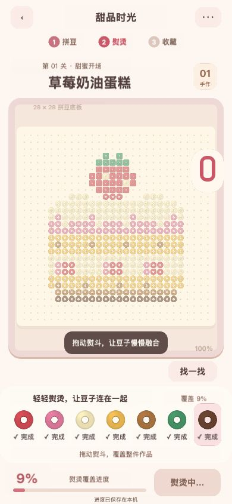

成品收藏：

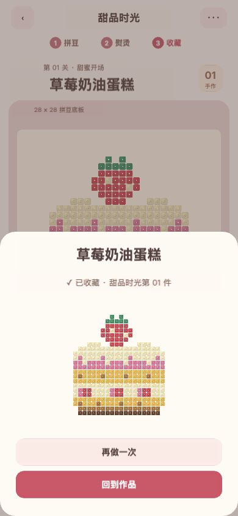

## 当前限制与后续

- 用户暂无 Cocos 开发者账号和微信 AppID。官方编辑器 GUI 显示登录要求；本次使用本地命令行完成导出，没有创建账号、接受注册协议或发布。
- 双指缩放/平移已实现并有状态机测试，尚未在真实多点触控设备人工验收。
- 微信存储、安全区和生命周期接口已接入，但微信开发者工具、iPhone、Android、音频中断和性能均待验证。
- 简短提示和可关闭音效已接入；尚未进行独立首次玩家的无讲解体验测试，不能据此确定单关时长与学习成本。
- 素材为程序绘制的豆子纹理、合成短音效和现有图纸数据。正式发布前还需逐项完成素材来源、名称、平台资格与发布材料核对。
- M2 首页、关卡列表、扩展作品集；M3 其余关卡；发布审核均未执行。

## 2026-10-18 放大后移动修复（历史方案，已由下一节替换）

原实现只有双指平移，鼠标放大后拖动仍走连续放豆。现改为：100% 时保持滑动铺豆；大于 100% 时点按放豆、直接拖动平移。点按延迟到松开确认，拖动超过 6 个逻辑像素后不再落豆；第二根手指或取消事件会清除待确认点按。未恢复工具按钮。

独立测试入口使用同一构建的 4313 端口，隔离测试进度，未清空用户 4312 端口的存档。实际操作验证 200% 下向右下拖动约 80×90 逻辑像素，画面随之移动，数量仍为 0/334；在新位置连续点按同一目标只增加一颗。反向拖动和边界限制正常，回到 100% 后横向拖动能完成同一行的 5 颗红豆。控制台无警告或错误。

新增 3 个回归用例覆盖点按抖动、拖动返回起点不转为放豆、手势取消。类型检查、关卡校验及 20 项测试通过，Web 和微信测试包同步更新。真实多点触控与微信真机限制仍如上。

同时修正短窗口中内容小于视口时偏移上限接近 0 的问题。最终在原试玩窗口放大到 160%，实际拖动约 45×35 屏幕像素，棋盘随之移动，用户已有的 250/334 进度保持不变。

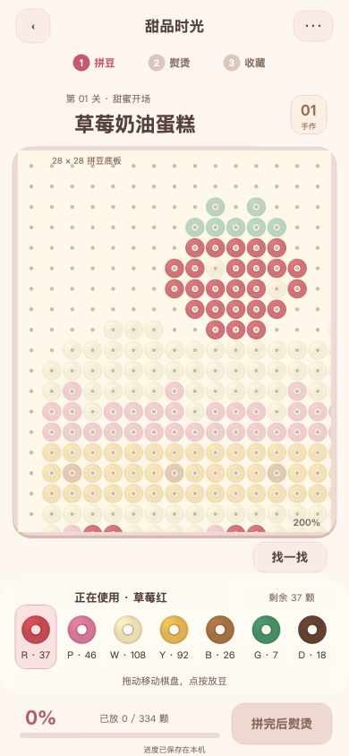

## 2026-10-18 放大后连续铺豆恢复

上一版把放大后的默认拖动改成平移，导致玩家无法连续铺豆。现统一为所有倍率默认滑动铺豆；手机双指移图，电脑右键拖动或按住空格加左键拖动移图，不增加工具按钮。画面按设备显示提示。

引擎会先把鼠标右键模拟成触摸，再派发鼠标按键事件。首个触点因此短暂等待按键确认或下一个调度周期，右键事件取消待放豆并转为平移。平移松键、取消、第二根手指、弹层和后台均清理手势，不把未结束的移图转为铺豆。

独立测试入口实测 200% 下普通左键一笔将数量从 5 增至 11，棋盘位置保持不变。增加 tests/browser-input.html 输入检查页，只派发 DOM 键鼠事件，不读写引擎内部状态：右键移图从 0/334 保持 0/334；空格移图从 1/334 保持 1/334；随后一笔铺豆增至 7/334。检查页和测试存档位于独立端口，原试玩存档未清空。

22 项纯逻辑测试、类型检查和关卡校验通过，Web 与微信测试包已同步。真实手机双指与微信真机仍待设备及 AppID。

重复输入检查时，将 tests/browser-input.html 复制为 build/input-test.html，再把 build 目录作为静态资源根目录，在独立端口打开 /input-test.html。先点放大，再按顺序执行右键移动、空格移动、连续铺豆，人工核对实际画面和数量；该检查页不属于游戏入口或微信包。

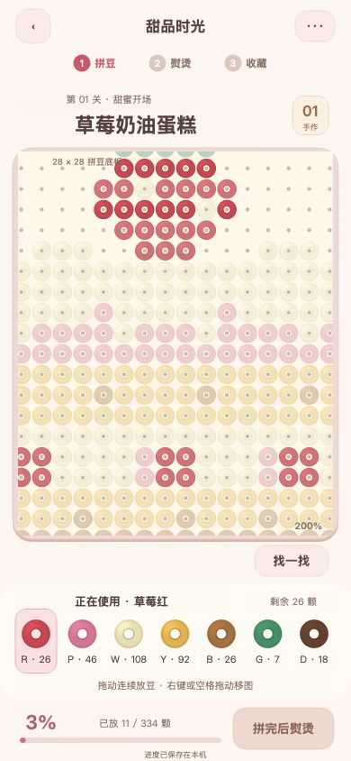

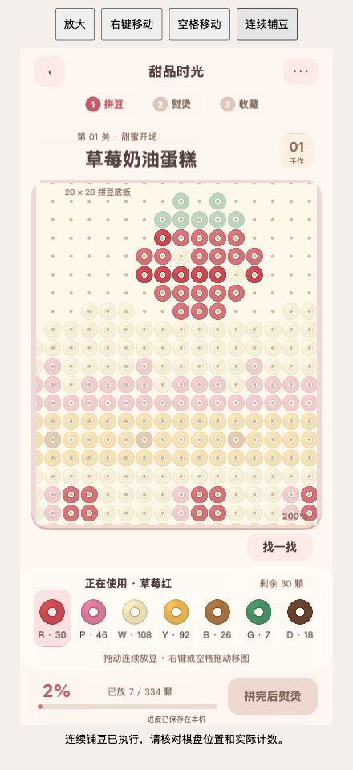

## 2026-10-18 找一找直接定位漏豆

按用户反馈替换“恢复全图高亮”的提示。现在优先找当前色的未完成格，以约 320ms 平滑放大并移动到画面中央；提示倍率为 2.4～3 倍，原有更高倍率保留。边缘豆子也可居中，并调整相同的手动移动边界以避免定位后开始拖动时跳回旧边界。

提示目标用白底红色描边和向下箭头持续闪动，填好、换色或重新制作时取消；再次点击按顺序定位下一颗，跳过完成格并循环。当前颜色已完成时帮玩家选中另一种未完成颜色并保存选色。提示本身不放豆，不改完成数。

新增 5 项规则测试覆盖循环、跳过完成位置、完成色回退、最后一颗、所有位置完成后停止提示，以及居中坐标、边缘目标和保持更高倍率。共 27 项测试、类型检查和关卡校验通过。

浏览器实际操作中，提示从 100% 放大到 240% 并居中，数量维持 11/334；再次提示切换目标，点按中心后变为 12/334 且标记消失。再放大到 300% 选择底部深色豆，提示仍保持 300% 并把边缘漏豆居中；滑动后增至 18/334，连续放豆和提示清除正常。测试入口使用独立端口，未清空原试玩记录。Web 和微信测试包已同步，微信真机限制仍保留。

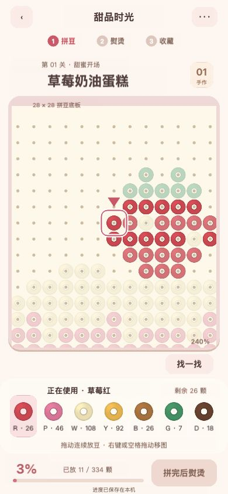

## 2026-10-18 抽屉外侧点击收起

原蒙层只拦截输入，没有关闭处理。普通抽屉现在可通过轻点外侧蒙层收起；抽屉自身也拦截空白区域的输入，内部点按不会误触关闭。移动超过 10 个逻辑像素视为拖动，起点在蒙层而终点进入抽屉时不关闭。存档异常阻断期间的恢复流程保留原行为。

独立端口人工验证设置抽屉内部空白保持展开、外侧点按关闭，蒙层拖动保持展开；重新制作确认抽屉可点外侧取消且不重置制作进度。以当前颜色未放置格作为关闭点击位置时，数量仍为 18/334，未发生点穿。类型检查通过，测试页面未见控制台警告或错误。Web 和微信测试包同步更新。

原试玩入口刷新后也完成设置抽屉外侧关闭检查，制作数量保持 73/334。

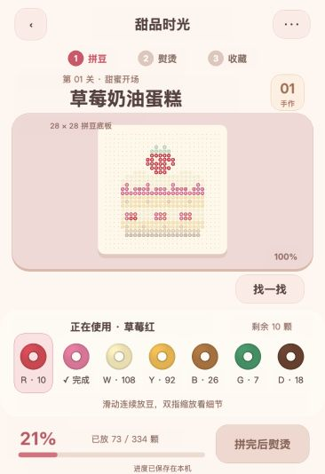

## 2026-10-18 粉色工作区背景扩展

按用户第二张截图红框扩大背景，将棋盘、找一找、色板和提示文字包在同一块粉色圆角区域内，底部进度和主按钮保留在区域外。容器由 362 扩至 370 个逻辑像素宽，向下延伸至底部安全区上方 68 个逻辑像素；移除色板原有的独立奶油白底，未选中色块背景与大容器保持一致。

棋盘视口、纸张、豆子尺寸、操作位置与制作存档不变。类型检查通过，Web 和微信测试包同步更新；本机已收藏页面目视检查通过。

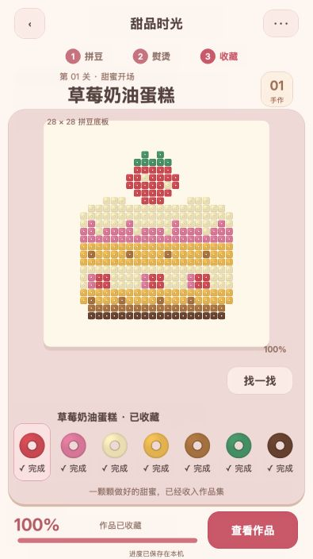

## 2026-10-18 标题精简与底板放大

按标注图将“草莓奶油蛋糕”移到顶部导航中央，移除“甜品时光”标题、“01 手作”徽章和色板上方的重复作品状态。章节说明保留在阶段下方。底板工作区上移，输入视口扩至 358 个逻辑像素宽，纸张和格子随可用宽高放大；“找一找”移至底板右上方，释放下部空间。熨烫遮罩与揭纸动画复位同步使用新的棋盘中心。

原试玩窗口目视检查标题、移除项与扩大后的底板，已收藏记录仍正常显示。独立端口在 390×844 下验证找一找放大至 240% 并居中漏豆，点击目标后从 18/334 增至 19/334，标记消失。类型检查、关卡校验、27 项测试通过，Web 与微信测试包同步更新。微信真机与多点触控验证限制仍保留。

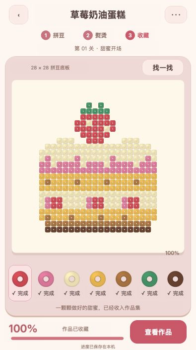

## 2026-10-18 合并关卡标题与精简文字

顶部改为“01关 草莓奶油蛋糕”，删除独立章节行、“28 × 28 拼豆底板”、已收藏阶段的色板下文案和常驻保存提示。工作区上移 16 个逻辑像素，保留当前底板宽度；制作中的操作指引及保存失败提示仍按实际状态出现。

类型检查通过，Web 和微信测试包已更新；原试玩页面已刷新，目视确认圈出的四处文字已移除，已收藏状态正常。

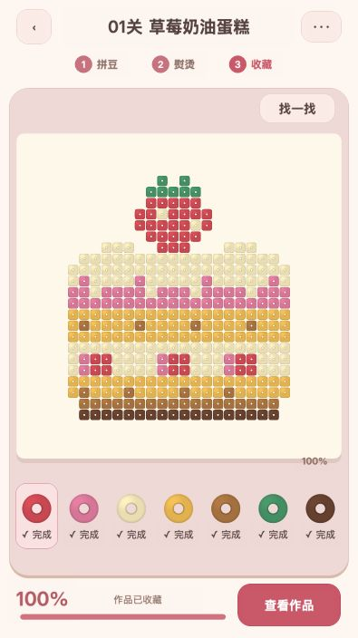

## 2026-10-18 镊子放豆光标

桌面制作阶段新增银色粉柄镊子，进入底板时隐藏原生指针，镊子尖端夹住当前颜色的豆子并与输入落点对齐。工具使用界面上层的矢量绘制与原豆子精灵，放大棋盘后工具本体大小保持稳定，夹持豆子适度放大；成功放豆时约 185ms 松夹并回夹。工具节点不拦截输入，连续铺豆仍沿原路径计算。选中已完成色时夹口为空，结束拼豆、移图、弹层、后台和离开视口时恢复普通光标。触摸设备不显示鼠标工具。

独立 4313 端口在 390×760 下验证：240% 定位后用镊子点击，从 19/334 增至 20/334；随后连续拖放增至 23/334。换到粉色后夹持豆子同步变色，点按空白不增加数量；点击找一找和打开设置抽屉时镊子隐藏。原试玩存档未重置。27 项测试、关卡校验和类型检查通过，最终光标切换调整后再次通过类型检查；Web 与微信测试包同步更新。微信真机与多点触控限制仍保留。

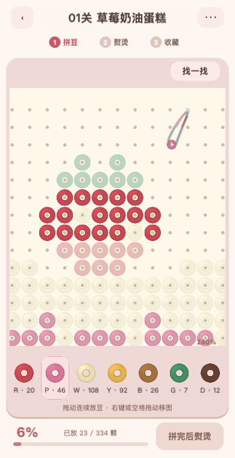

## 2026-10-18 参考实物图更换粉紫镊子

按用户提供的粉紫双色塑料镊子照片，用矢量曲线替换原银色细臂造型，增加粉色上臂、紫色下臂、宽柄弯头、侧面明暗和五道防滑纹。夹口仍围绕原落点中心张合，沿用选色、落豆动画、鼠标恢复和连续铺豆逻辑。

类型检查通过，独立预览下目视核对新造型；240% 定位后点击夹口中心，数量从 23/334 增至 24/334，提示标记正确消失，控制台无警告或错误。Web 和微信测试包同步更新。

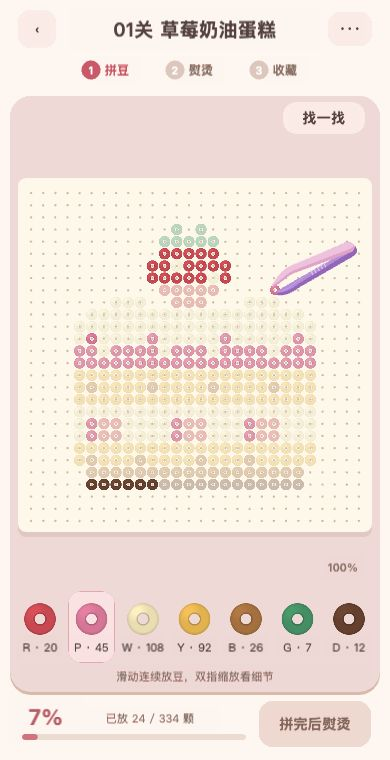

## 2026-10-18 夹持豆子与棋盘尺寸一致

修正夹持豆子原先采用 0.85 比例、且限制为 7～16 个逻辑像素的问题。棋盘暴露共用的豆子边长，夹持精灵使用该边长乘当前倍率，与棋盘的 0.95 格宽精灵一致；移除松夹动画中的豆子缩小，保留夹臂张合和显隐反馈。

类型检查通过；隔离预览目视核对 100% 与 240% 下的尺寸，提示与空白点击均未增加制作数量。Web 和微信测试包已同步更新。

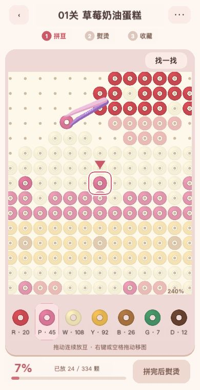

## 2026-10-18 镊子与豆子整体等比缩放

此前仅将放大后的豆子尺寸传入夹口曲线，柄部仍使用固定坐标，导致夹口被撑开而镊子变形。现传入未缩放豆子边长与独立倍率，镊子及夹持豆子共用父节点的等比缩放；曲线、宽度、防滑纹和动画幅度随整体同步变化，鼠标落点位置保持原坐标。

类型检查通过，隔离预览目视检查 100%、120% 和 300% 的比例。300% 下找一找仍保持倍率，点击中心目标从 24/334 增至 25/334，标记消失，控制台无警告或错误。Web 和微信测试包已同步更新。

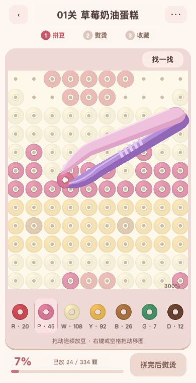

## 2026-10-18 预览更新与旧缓存隔离

用户页面仍显示旧版的固定柄部。核对 4312 服务目录与返回的主脚本均为新版，原简单静态服务仍允许缓存和 304 响应。新增 scripts/preview.py，入口根据主脚本内容哈希转到 `/preview/<版本>/first-level/`，所有相对资源地址随入口版本改变；服务统一返回 no-store 并忽略旧条件请求。相同来源的存档不受路径变化影响，旧版本入口会转到当前版本。README 的启动命令同步改为新服务。

实测版本入口返回 200，主脚本与磁盘一致；即使请求附带未来日期的 If-Modified-Since，仍返回最新文件及禁止缓存响应头。替换 4312 服务并直接切换用户当前标签页至新版，实际检查 300% 下镊子、豆子整体放大，制作数量保持 131/334，控制台无警告或错误。

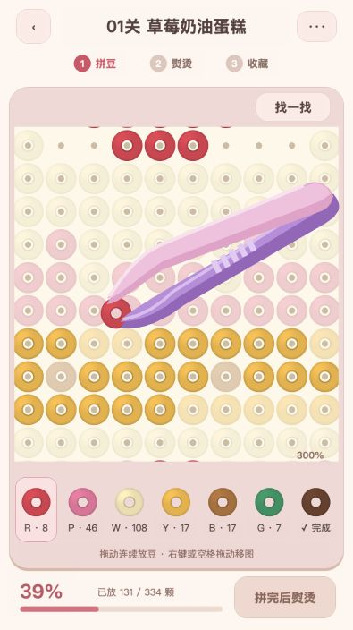

## 2026-10-18 放大镜按钮

将“找一找”文字按钮替换为放大镜图标，保留 44×44 点击范围和定位剩余豆子的交互。类型检查、网页构建和实际点击定位验证通过；点击后放大至 240%，进度保持 149/334。截图：`screenshots/magnifier-button.png`。

网页版本：`http://127.0.0.1:4312/preview/bcf960c9fd30/first-level/`。

额外同步微信测试包时遇到 Cocos CLI 导入器注册异常，完整性检查已阻止交付。异常过程把资源元数据改为通用导入器；已保留 UUID 并恢复对应导入器身份，标为待重新导入。失败的微信输出移至 `.tools/wechatgame-import-failed-*`，原缓存及元数据备份保留在 `.tools/import-recovery-1792334186/`。后续微信构建前仍需修复导入初始化，并重新生成子资源元数据。当前网页构建不受影响。

## 2026-10-18 透明分色豆盒

按用户参考图，将底部七颗单色按钮改为七个透明塑料豆盒，增加盒口、透光前壁、反光线和多角度小圆筒豆堆。余量决定可见豆堆层数，完成后留空盒；选中盒上抬并使用粉色边框及短线，保留余量文字。

类型检查和正式网页构建通过，资源完整性检查通过；此前被异常导入改写的项目资源已在此次网页构建中重新正常导入。实际点击黄盒及粉盒确认选色切换正常，进度保持 149/334，浏览器无错误日志。微信包本次未重建。截图：`screenshots/transparent-bead-boxes.png`。试玩地址：`http://127.0.0.1:4312/preview/87dbe2626621/first-level/`。

## 2026-10-18 抽拉式分色豆盒

将敞口豆盒改为固定外壳加可滑动豆盘，未选中默认关闭；当前选中且有剩余豆子的颜色拉开，露出堆豆。前脸与有色把手随豆盘一起移动，换色同步收回与打开，240ms 缓动，重复刷新不重播。已完成色和非拼豆阶段保持收合；保留余量、完成标记和原进度。

类型检查、网页构建及完整性检查通过。实际点击白色→绿色→已完成红色，确认前一抽屉收回且完成色关闭；再点放大镜，确认粉色抽屉自动拉开并定位至 240%。进度全程保持 149/334，浏览器无错误。截图：`screenshots/bead-drawers.png`。试玩：`http://127.0.0.1:4312/preview/b04b84987681/first-level/`。

## 2026-10-18 透明外壳与分色前板

降低外壳、顶板和内托填充透明度，增加斜向反光，抽屉关闭时透出豆子；抽屉前板改为对应豆色的大色块，搭配白色把手和同色深描边，移除选中时的统一粉色描边。保留抽拉动画和库存规则。类型检查、网页构建和资源完整性检查通过；浏览器实际棕色→绿色→棕色切换正常，进度维持 149/334，无错误日志。构建中遇到的导入异常已恢复，最新正常元数据备份于 `.tools/last-good-resource-metadata/`。截图：`screenshots/clear-drawer-shells.png`。试玩：`http://127.0.0.1:4312/preview/621d1b17027f/first-level/`。

## 2026-10-18 未拼目标区分、完成色抽屉与底板尺寸

未拼目标采用低饱和、较淡颜色，已放豆子保留原色与完整不透明度；当前选中色的未拼位置略清楚，提示仍用描边和箭头定位。完成色现在也能正常拉开空抽屉，保留“完成”标记并提示换色；全部拼好待熨烫时仍可查看选中抽屉。右下角缩放倍率改为动态读取关卡宽高的“28×28”，不影响缩放交互。

直接运行 TypeScript 编译器检查通过（pnpm 包装入口因工作区结构校验拒绝执行，未重装依赖）。网页构建和资源完整性检查通过。实际点击已完成红色确认空抽屉拉开，再切换白色及滚轮放大确认“28×28”保持，进度全程 149/334，浏览器无错误日志。截图：`screenshots/completed-drawer-open.png`、`screenshots/target-contrast-and-board-size.png`。试玩：`http://127.0.0.1:4312/preview/41df184556fa/first-level/`。

## 2026-10-18 提高待拼位置可见度

根据用户反馈，撤回过度灰淡效果。当前选色的未拼目标保留约 65% 原饱和度、195/255 透明度，其余目标保留约 50% 原饱和度、125/255 透明度，提示目标 220/255；已拼豆子继续使用完整原色。新增独立的目标圆环绘制层，仅为当前选色且未填的位置描边，奶油白使用加深后的边线以免融入底板；切色和填豆刷新时同步更新。

类型检查、网页构建及完整性检查通过；实际检查白色目标的默认与放大状态，切换粉色后描边正确转移，数量保持 149/334，浏览器无错误。两个打开的试玩标签均已刷新。截图：`screenshots/readable-unfilled-targets.png`。试玩：`http://127.0.0.1:4312/preview/2779509d2991/first-level/`。

## 2026-10-18 点击豆盒切换开合

增加独立的 openDrawerColor 状态。点击打开的豆盒收回，点击关闭的豆盒打开并选色，同时收回其他豆盒；关闭不会清除选色，也不会因刷新、缩放或界面重建自动重开。放大镜定位仍会打开对应颜色的抽屉。完成色使用同样的开合规则。

类型检查、网页构建及资源完整性检查通过。实际验证棕色抽屉打开→点击关闭→滚轮缩放后仍关闭→再次点击打开→点击粉色打开并收回棕色，全程保持 160/334，浏览器无错误。两个标签已更新。截图：`screenshots/drawer-toggle-closed.png`、`screenshots/drawer-toggle-open.png`。试玩：`http://127.0.0.1:4312/preview/eea4f1cce0da/first-level/`。

## 2026-10-18 关闭豆盒同时取消选色

关闭当前豆盒后将 selectedColor 设为 null，取消选色高亮和未拼目标描边，隐藏夹豆镊子；未选色时放豆返回 no-color-selected，并提示打开豆盒选色。重新打开豆盒恢复对应颜色，放大镜可从空选色寻找未完成颜色并打开对应抽屉。存档接受 null，保留对旧数字色号的兼容。

新增取消选色后的落豆拦截与重新选色、空选色提示定位、空选色存档与进度恢复三项回归测试，共 30 项测试通过。类型检查、网页构建与资源完整性检查通过。浏览器实际打开粉色→关闭→点击待拼位置，数量保持 163/334，无高亮与夹豆指针；刷新后仍未选色。两个试玩标签均已更新。截图：`screenshots/closed-drawer-no-selection.png`。试玩：`http://127.0.0.1:4312/preview/ef9f4fcbcc5a/first-level/`。

## 2026-10-18 熨烫封孔与整片成品

按用户实物参考，新增连续封孔表面：所有有效目标格中心不透明，相邻格直接相接，无豆孔或逐颗缝隙。使用确定性细颗粒纹理和仅在外轮廓处的柔和圆角、边缘明暗，保持关卡颜色和形状。FusedSurface 生成像素数据；FusedArtwork 负责共享纹理绘制及资源清理，BoardView 按已熨烫区域显示，收藏弹层直接复用完整表面。拼豆阶段继续使用圆环豆。

新增所有有效格封孔与空格透明、相邻异色区无透明缝隙两项测试，共 32 项测试通过。类型检查、网页构建和资源完整性检查通过。用户现有已收藏作品在棋盘和收藏弹层均显示无孔成品，浏览器无错误。未重置存档、未改动收藏和数量。截图：`screenshots/sealed-finish-board.png`、`screenshots/sealed-finish-collection.png`。试玩：`http://127.0.0.1:4312/preview/c23eb0005de9/first-level/`。

## 2026-10-18 落实确认后的轻质感成品

用户确认最终参考图 `references/fused-finish-approved.png`，已保存到项目作为材质方向。FusedSurface 调整为更柔和的外轮廓、轻微混合的异色交界、低对比多尺度颗粒和极浅的封孔压痕；降低边缘明暗和闪点强度，不加入逐格鼓包或明显拼缝。FusedArtwork 增加低透明度、短偏移接触阴影，表面与影子共享纹理，棋盘和收藏展示复用。

类型检查、32 项测试、网页构建和资源完整性检查通过。实际检查已收藏作品棋盘和收藏弹层，均无孔洞、无错误日志；未重置用户进度。截图：`screenshots/approved-light-finish-board.png`、`screenshots/approved-light-finish-collection.png`。试玩：`http://127.0.0.1:4312/preview/1abd4eb8e754/first-level/`。

## 2026-10-18 直接接入确认的生成素材

用户确认透明底生成图后，将原 PNG 原样复制为 `assets/resources/art/finished-cake.png`，未再次简化图像。启动与重试预加载成品精灵；FusedArtwork 在全部熨烫或已收藏状态直接显示图片，按有效作品边界等比适配，隐藏此前的过程纹理与阴影。棋盘与收藏弹层使用同一素材；局部熨烫覆盖继续使用格子表面。

类型检查、32 项测试、网页构建和资源完整性检查通过；实际检查棋盘和收藏弹层的纹理、压痕、边缘高光、透明背景均正常，无浏览器错误；原有收藏与制作进度未改变。截图：`screenshots/generated-finish-board.png`、`screenshots/generated-finish-collection.png`。试玩：`http://127.0.0.1:4312/preview/c0e5a451bdd4/first-level/`。

## 2026-11-03 首页导航阶段验证

已接入首页、首关继续入口和返回首页确认，提供横屏紧凑布局。类型检查、32 项既有测试和网页构建资源检查通过。使用隔离端口浏览器验证：空存档进入首关，放置一颗后返回首页显示 1/334，刷新后仍显示 1/334。测试没有使用用户原有端口的存档。

仍待验证：熨烫、待领取、已收藏状态通过首页继续；保存失败与损坏存档恢复；真实设备布局和微信生命周期。关卡列表及完整作品集尚未实现，首页入口显示即将开放。暂不勾选 T13 完成。

## 2026-11-03 单关导航闭环

首页已接入第一关列表、作品集与成品详情；当前只有草莓蛋糕，更多关卡提示制作中，不显示为可玩。可从首页继续、查看作品集和重玩；详情返回作品集，返回首页前尝试保存，失败时留在当前页面并提示重试。已收藏作品重玩保留通关与收藏。

隔离端口验证：首页→关卡列表→首页→作品集；放豆后返回和刷新保留 1/334；模拟熨烫中、待揭纸和已收藏存档，首页状态显示正确；收藏详情及重玩保留收藏；注入存储写失败时阻止返回，损坏记录时提示恢复且保留原始数据。类型检查、关卡校验、32 项现有测试与网页构建资源检查通过。微信开发者工具、真机与多点触控未测；其余 19 关、完整两主题展架和顺序解锁仍待实现，T14/T15 不标记全部完成。

## 2026-11-03 三关导航试玩

新增原创格子图纸樱桃苏打（338 颗）和焦糖布丁（319 颗）；关卡列表显示三件作品与顺序解锁状态，作品集按关卡独立展示收藏。首关保留原有存储键，后两关使用独立双槽键，最近关卡单独记录；已完成作品可重玩且保留收藏。非首关成品使用该关图纸的通用融合渲染，不复用草莓蛋糕图。

隔离预览以合成已收藏记录验证第一关解锁第二关、第二关解锁第三关、进入第三关后刷新恢复最近关卡；以待揭纸记录验证第三关领取和独立收藏。三张图纸校验、类型检查、34 项测试和网页构建检查通过。新关卡尚未进行从零逐颗完成的人工试玩，微信构建、真机和 AppID 验证仍待进行。图案和成品效果为首版，待用户验收。

## 2026-11-03 新关卡成品质感

根据反馈，以第一关已确认成品为材质参考，以第二、三关图纸为形状参考，使用内置 imagegen 生成透明底熨烫成品 `finished-soda.png` 与 `finished-pudding.png`。各关的棋盘完整熨烫、首页预览、关卡列表、作品集及收藏弹层共用相应素材；局部熨烫仍由程序渲染。调整收藏弹层成品尺寸和位置，避免遮挡按钮。

类型检查、34 项既有测试与网页构建通过。隔离浏览器实看第二关收藏弹层与作品集，素材显示及按钮布局正常；第三关素材已在作品集检查。生成素材尽量沿用图纸轮廓，但细节由生成模型重绘，最终美术效果待用户验收；微信真机未测。

## 2026-11-03 关卡列表作为首页

根据反馈，取消单独的作品首页，启动、游戏返回及成品返回统一进入关卡列表；选关页保留作品集入口和音效开关。隔离预览验证启动直接显示关卡列表，作品集返回列表正常；类型检查及网页构建通过。

## 2026-11-03 新增第 4～6 关

增加奶油松饼（335 颗）、水果三明治（213 颗）、猫咪咖啡杯（251 颗）图纸与对应透明底熨烫成品。成品由内置 imagegen 以各自格子图纸为构图、首关成品为材质参考生成；生成图细节可能与图纸存在差异，待用户评审。选关按三关一页、作品集按四件一页；短窗口使用更紧凑的分页布局。新会话默认选中图纸中实际使用的颜色。

六关图纸校验、类型检查、35 项测试与网页构建通过。隔离预览验证选关分页、以模拟收藏解锁第六关并进入，以及五件收藏的作品集分页；新增三关尚未从零逐颗完成、微信开发者工具及真机未测。测试不使用用户当前试玩存档。

## 2026-11-03 关卡与作品集连续浏览

根据反馈取消选关及作品集分页，两个页面均以双列卡片纵向浏览；关卡卡片直接点击进入，锁定关卡仍由入口校验阻止。仅已收藏作品进入作品集。隔离预览检查六关双列、短窗口的滚轮与模拟触摸滑动、卡片点击及作品集滚动；类型检查、35 项测试和网页构建通过。真实微信真机触摸仍待验证。
